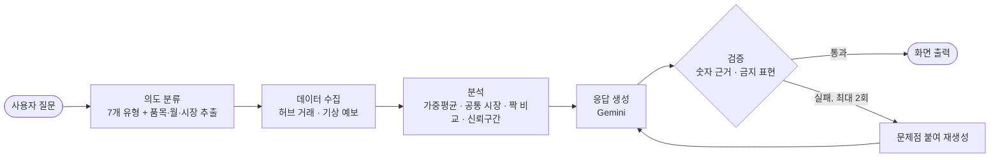

# 🥕 제주 당근 출하·판로 의사결정 AI Agent

제주 당근(세척당근·흙당근) 농가와 작목반이 **"지금 값이 어떤지, 언제·어느 시장에 내는 게 나은지"**를 일상 언어로 물으면,
제주데이터허브의 도매시장 거래 데이터와 기상청 예보를 분석해 근거 숫자와 함께 답해 주는 AI 에이전트입니다.

- 필수 데이터: 제주데이터허브 「농산물 품종별 일일 거래 정보」 (원출처: aT 도매유통정보시스템)
- 보조 데이터: 기상청 단기예보 조회서비스 (공공데이터포털)
- 데이터 상세(출처·이용조건·전처리·한계): [DATA_SPEC.md](DATA_SPEC.md)
- 사용 방법(도민용): [USER_MANUAL.md](USER_MANUAL.md)

---

## 1. 무엇을 할 수 있나요

| 질문 유형 | 예시 질문 | 분석 내용 |
|---|---|---|
| 가격 조회 | 요즘 제주 당근 가격 작년보다 어때? | 거래량 가중평균가, 전년 같은 기간 대비(두 해 모두 거래된 시장끼리), 최근 14일 흐름 |
| 출하 시기 | 1월이랑 2월 중에 언제 출하하는 게 나아? | 월별 가중평균가 비교, 차이의 95% 신뢰구간, 출하 예정일 날씨 위험 |
| 거래량 현황 | 요즘 당근 거래량 많은 편이야? | 총거래량·하루 평균, 최근 3개월 하루 평균 대비(두 기간 모두 거래된 시장 기준), 일별 거래량 추이 |
| 날씨 영향 | 이번 주 한파 오면 당근 값에 영향 있어? | 구좌읍 단기예보(강수·강풍·영하권)와 현재 가격 수준 |
| 시장 비교 | 가락시장이랑 다른 시장 중에 어디가 더 비싸? | 거래량 비중 2% 이상 시장끼리 가중평균가 비교, 요청 시장 vs 나머지 |
| 세척·흙 비교 | 세척당근이랑 흙당근 중에 뭐가 더 유리해? | 같은 날·같은 시장끼리 짝지은 가격 차이(Ȳ, S, 95% 신뢰구간) |

답변은 "비슷해요(차이 5% 미만) / 차이가 있어 보이지만 우연일 수도 있어요(신뢰구간에 0 포함) / 뚜렷한 차이가 있어요"처럼
**통계적 불확실성을 함께 말하도록** 설계했고, 모든 답변은 규칙 기반 검증을 거칩니다.

## 2. 동작 구조



| 단계 | 파일 | 설명 |
|---|---|---|
| 의도 분류 | `agent/nodes.py` `intent_router` | Gemini 구조화 출력으로 7개 의도와 파라미터(품목, 월, 비교 연도, 시장) 추출 |
| 데이터 수집 | `agent/nodes.py` `data_fetcher`, `api/` | 의도에 필요한 데이터만 호출. API 실패 시 저장 데이터로 대체 |
| 분석 | `agent/analyzer.py` | 질문 유형별 통계 분석 → 숫자 카드·차트·표·근거(facts)·주의사항(caveats) |
| 응답 생성 | `agent/nodes.py` `response_generator`, `agent/prompts.py` | 분석 결과만 근거로 답변. 실패 시 분석 숫자만으로 기본 답변 |
| 검증 | `agent/validators.py`, `agent/validators_extra.py` | 분석에 없는 숫자, 미래 단정, 내부 용어, 숫자 날짜, 없는 시장 이름, 지시문 유출 검사 |
| 재시도 | `agent/graph.py` | 검증 실패 시 문제점을 프롬프트에 붙여 최대 2회 재생성 |
| 화면 | `app.py` | Streamlit 채팅, 숫자 카드·차트·표, 데이터 상태 배지, 에이전트 실행 과정 |

## 3. 설치

### 요구 사항
- Python 3.11 이상
- 인터넷 연결 (Gemini API 호출용. 데이터는 저장본으로도 동작)

### 설치 순서

```bash
# 1. 제출 ZIP을 압축 해제한 뒤 폴더로 이동
cd jeju_agent

# 2. (선택) 가상환경
python -m venv .venv
# Windows: .venv\Scripts\activate    macOS/Linux: source .venv/bin/activate

# 3. 패키지 설치
pip install -r requirements.txt
```

#### Windows에서 막힐 때

- `python`을 입력했는데 `Python`이라는 글자만 나오거나 Microsoft Store가 열리면, Windows 기본 바로가기가 잡힌 것입니다. `py`를 쓰거나(예: `py -m pip install -r requirements.txt`) 아래처럼 가상환경의 파이썬을 경로로 직접 실행하세요.
- `.venv\Scripts\activate`에서 "이 시스템에서 스크립트를 실행할 수 없으므로" 오류가 나면, activate 없이 가상환경 파이썬을 직접 부르면 됩니다.

```powershell
py -m venv .venv
.venv\Scripts\python.exe -m pip install -r requirements.txt
.venv\Scripts\python.exe -m streamlit run app.py
```

(activate를 쓰고 싶다면 `Set-ExecutionPolicy -Scope CurrentUser RemoteSigned`를 한 번 실행한 뒤 다시 시도하세요.)

### API 키 설정

`.env.example`을 복사해 `.env`를 만들고 키를 입력합니다.

```bash
cp .env.example .env        # Windows PowerShell: copy .env.example .env
```

| 변수 | 필수 | 발급처 | 용도 |
|---|---|---|---|
| `GEMINI_API_KEY` | **필수** | [Google AI Studio](https://aistudio.google.com/) | 의도 분류·응답 생성 |
| `JEJU_HUB_KEY` | 선택 | [제주데이터허브](https://www.jejudatahub.net) 프로젝트 키 | 실시간 거래 데이터 |
| `DATA_GO_KR_KEY` | 선택 | [공공데이터포털](https://www.data.go.kr/data/15084084/openapi.do) 기상청 단기예보 | 실시간 기상 예보 |
| `USE_MOCK_DATA` | 선택 | - | `true`면 API 대신 `data/snapshot` 저장 데이터 사용 |

**Gemini 키만 있어도 실행할 수 있습니다.** `USE_MOCK_DATA=true`로 두면 허브·기상청 키 없이 저장된 실제 데이터(2023-11 ~ 2026-11)로 전체 기능을 확인할 수 있습니다.
허브·기상청 키를 넣었더라도 API 호출이 실패하면 자동으로 저장 데이터로 답하고, 화면에 "💾 저장된 데이터 사용 중"이 표시됩니다.

`.env`는 `.gitignore`에 포함되어 있으니 키를 커밋하지 마세요.

화면의 "에이전트가 한 일 보기"에 `401 UNAUTHENTICATED` / `API key not valid`가 보이면 `GEMINI_API_KEY`가 잘못 입력된 것입니다. `your_key_here`가 남아 있지 않은지, 키 앞뒤에 따옴표나 공백이 없는지 확인하세요.

#### 평가용 키 (심사위원용)

- 제출 ZIP에는 평가용 Gemini API 키를 `평가용_API_KEY.txt`로 함께 넣었습니다. 이 키를 `.env`의 `GEMINI_API_KEY`에 넣고 `USE_MOCK_DATA=true`로 실행하면 됩니다. (평가 기간이 끝나면 키는 폐기합니다.)
- 제주데이터허브·기상청 키는 대회 규정에 따라 제출물에 포함하지 않았습니다. 위 표의 발급처에서 직접 발급해 `.env`에 넣으면 실시간 데이터로 동작합니다.

## 4. 실행

```bash
streamlit run app.py              # Windows: py -m streamlit run app.py
```

브라우저에서 `http://localhost:8501`이 열립니다. 왼쪽 예시 질문 버튼을 누르거나 채팅창에 질문을 입력하세요.

그래프만 터미널에서 실행해 보려면:

```bash
python -m agent.graph
```

## 5. 테스트

LLM·API 없이 저장 데이터만으로 확인할 수 있는 테스트와, Gemini를 호출하는 테스트가 있습니다.

| 명령 | Gemini 호출 | 확인 내용 |
|---|---|---|
| `python scripts/test_analyzer.py` | ✗ | 6개 질문 유형별 분석 결과 출력 (`python scripts/test_analyzer.py wash_vs_soil`처럼 한 유형만 가능) |
| `python scripts/test_validators.py` | ✗ | 좋은 답변은 통과, 숫자 지어냄·미래 단정·내부 용어·숫자 날짜는 실패하는지 |
| `python -W ignore -m tests.run_questions` | ○ (적음) | 테스트 질문 20개의 의도·파라미터 분류 정확도 → `tests/results.csv` |
| `python -W ignore -m tests.run_questions --edge` | ○ (적음) | 애매한 질문·복합 질문 등 엣지 케이스 → `tests/results_edge.csv` |
| `python -W ignore -m tests.run_questions --full` | ○ (많음) | 답변 생성·검증·재시도까지 전체 흐름 |

데이터 확인용 스크립트:

| 명령 | 설명 |
|---|---|
| `python scripts/check_hub.py` | 허브 API 품종별 전체 건수(totCnt) 확인 |
| `python scripts/check_weather.py` | 기상청 API 연결 확인 |
| `python scripts/build_snapshot.py` | 저장 데이터(`data/snapshot`) 갱신 (허브 키 필요) |
| `python scripts/check_snapshot_match.py` | 실시간 API와 저장 데이터의 건수·거래량·가중평균가 일치 확인 (허브 키 필요) |

## 6. 폴더 구조

```
jeju_agent/
├── app.py                  # Streamlit 화면
├── config.py               # 모델명, 재시도 횟수, API 키 로드
├── agent/
│   ├── graph.py            # LangGraph 흐름 (의도→수집→분석→응답→검증→재시도)
│   ├── nodes.py            # 각 단계(노드) 구현
│   ├── state.py            # 노드 간 공유 상태
│   ├── schemas.py          # 의도 분류 구조화 출력 스키마
│   ├── prompts.py          # LLM 프롬프트
│   ├── analyzer.py         # 질문 유형별 통계 분석
│   ├── validators.py       # 답변 검증 (숫자 근거, 금지 표현 등)
│   ├── validators_extra.py # 추가 검증 (지시문 유출, 없는 시장 이름)
│   └── utils.py            # 재시도 도우미
├── api/
│   ├── jeju_hub.py         # 제주데이터허브 거래 데이터 클라이언트
│   └── weather.py          # 기상청 단기예보 클라이언트
├── data/snapshot/          # 저장 데이터 (API 장애 대응·키 없이 실행용)
├── scripts/                # 데이터 확인·분석/검증 단독 테스트
├── tests/                  # 테스트 질문 일괄 실행
├── DATA_SPEC.md            # 데이터 활용 명세
└── USER_MANUAL.md          # 사용자 매뉴얼
```

## 7. 분석 방법 요약

- **거래량 가중평균**: 같은 날·같은 시장에 법인별로 여러 거래가 있고 소량 거래 가격이 극단적인 경우가 많아, 시장 가격은 Σ(가격ᵢ × 거래량ᵢ) / Σ거래량ᵢ 로 계산합니다.
- **공통 시장 비교**: 허브 데이터는 해마다 집계되는 시장 수가 달라(예: 세척당근 2025년 15곳 → 2026년 23곳) 전년 대비는 두 해 모두 거래된 시장끼리만 비교합니다.
- **시장 비교 기준**: 거래일 3일 이상, 기간 거래량 비중 2% 이상인 시장끼리 최고·최저를 비교하고, 나머지는 "참고용"으로 표시합니다.
- **세척·흙 짝 비교**: 전체 평균끼리 비교하면 시장 구성 차이가 섞여 결론이 뒤집힐 수 있어(전체 평균 +425원 vs 짝 비교 −30원), 같은 날·같은 시장끼리 짝지어 평균 차이 Ȳ와 95% 신뢰구간(Ȳ ± t·S/√n)을 계산합니다.
- **두 기간 비교**: 일별 가중평균 가격으로 Welch 방법의 95% 신뢰구간을 계산해, 0을 포함하면 "우연일 수도 있어요"로 판정합니다.

## 8. 자주 나는 오류와 대응

| 증상 | 원인 | 대응 |
|---|---|---|
| `401 UNAUTHENTICATED` / `API key not valid` | Gemini 키가 틀림 | `.env`의 `GEMINI_API_KEY` 확인 (따옴표·공백 없이) |
| `429` / `RESOURCE_EXHAUSTED`, 답변이 늦음 | Gemini 호출 한도 초과 | 자동으로 대기 후 재시도합니다. 계속되면 잠시 뒤 다시 질문하거나 한도가 넉넉한 키 사용 |
| "데이터를 가져왔지만 답변을 만들지 못했어요" | Gemini 호출이 끝내 실패 | 인터넷 연결과 키 확인. 화면의 검증 결과는 "확인 필요"로 표시됩니다 |
| 답변까지 약 1분 걸리고 "💾 저장된 데이터 사용 중" 표시 | 허브 키가 없거나 틀림, 허브 서버 오류(502) | 정상 동작입니다(최대 5회 재시도 후 저장 데이터로 답변). 빠르게 확인하려면 `USE_MOCK_DATA=true` |
| "최신 예보를 가져오지 못해 저장된 예보(…발표)를 보여 드려요" | 기상청 키가 없거나 호출 실패 | 마지막으로 저장된 예보를 사용합니다. 실시간 예보는 `DATA_GO_KR_KEY` 설정 |
| `python`을 찾을 수 없음, `activate` 실행 불가 | Windows 기본 설정 | 3장의 "Windows에서 막힐 때" 참고 |
| `ModuleNotFoundError` | 패키지 미설치 또는 다른 폴더에서 실행 | 저장소 폴더 안에서 `pip install -r requirements.txt` 후 다시 실행 |

외부 서비스 의존성: Gemini API는 **필수**(인터넷 필요), 제주데이터허브(일 3,000회)·기상청(일 10,000회) API는 **선택**이며 실패 시 저장 데이터로 대체합니다.

## 9. 한계

- 미래 가격을 예측하지 않습니다. 과거 같은 시기의 흐름과 현재 수준을 보여 줄 뿐입니다.
- 세척 비용·운송비 등 농가별 비용 데이터가 없어 실제 수익 차이는 판단하지 않습니다.
- 날씨가 가격에 미치는 영향(인과관계)은 이 데이터로 확인할 수 없습니다. 예보는 앞으로 약 4일 범위입니다.
- 허브 데이터는 2026년 3월 무렵부터 집계 건수가 크게 늘어, 거래량 증감에는 집계 범위 변화가 섞여 있을 수 있습니다.
- 자세한 내용은 [DATA_SPEC.md](DATA_SPEC.md) 6장을 참고하세요.

## 10. 사용 기술

Python 3.11 · LangGraph · LangChain (Google GenAI) · Gemini · pandas · Streamlit · requests · python-dotenv · pydantic

- **LLM**: Google Gemini `gemini-3.5-flash-lite` (의도 분류·답변 생성). `.env`에 `GEMINI_MODEL=모델명`을 넣으면 다른 Gemini 모델로 바꿀 수 있습니다.
- **라이브러리 버전**: `requirements.txt`에 고정 (langgraph 1.2.21, langchain-google-genai 4.5.0, google-genai 3.3.0, pandas 3.0.6, streamlit 1.67.0 등)

## 11. 개발 과정의 AI 도구 활용

대회 규정에 따라 개발 과정에서 사용한 생성형 AI 도구와 활용 범위를 밝힙니다. Agent 안에서 쓰는 LLM(Gemini)은 10장을 참고하세요.

- **사용 도구**: Claude (Anthropic)
- **활용 범위**: 코드 초안 작성과 오류 원인 분석, 테스트·데이터 확인 스크립트 초안, 문서 초안 작성과 검토

AI가 작성한 코드와 문서는 팀원이 직접 실행·검토한 뒤 반영했으며, 답변과 문서의 모든 분석 수치는 실제 데이터로 코드가 계산한 결과입니다.
